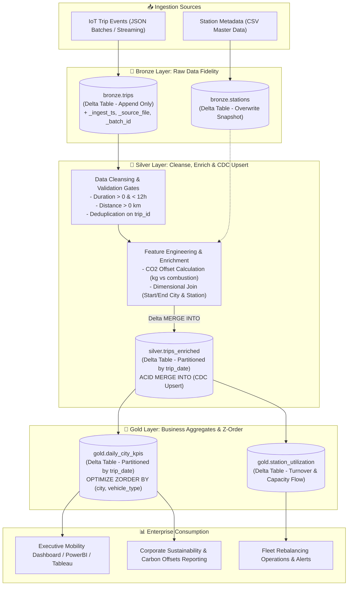

# 🚲 Databricks Smart Mobility Lakehouse

[](https://www.python.org/)
[](https://spark.apache.org/)
[](https://delta.io/)
[](https://databricks.com/)
[](https://github.com/astral-sh/ruff)
[](https://mypy-lang.org/)
[](https://pytest.org/)

An enterprise-grade **Lakehouse Architecture** for multi-modal urban mobility (e-bikes, e-scooters, and EV car-sharing across **Paris, Lyon, Lille, Toulouse, and Nantes**). Built with **PySpark** and **Delta Lake 3.2**, this repository implements a complete **Medallion Architecture (Bronze $\to$ Silver $\to$ Gold)** featuring ACID transactions, Change Data Capture (CDC) upserts, carbon-saving feature engineering, and multi-dimensional Z-Ordering.

---

## 🏗️ Architecture & Medallion Data Flow



---

## ⚡ Key Architectural Patterns

### 1. Bronze Layer (Raw Ingestion & Lineage Tracking)
- **Zero Loss & Schema Evolution:** Ingests raw JSON trip events and station catalogs directly into Delta tables without lossy transformations.
- **Audit Columns:** Appends technical metadata to every record:
  - `_ingest_timestamp`: Microsecond timestamp when data entered the lakehouse.
  - `_source_file`: Lineage back to the original source payload.
  - `_batch_id`: Batch job identifier for replayability and idempotent tracking.

### 2. Silver Layer (Cleansing, CO2 Features & Delta ACID Merge)
- **Quality Gates:** Filters out GPS drift, negative distances, and anomalous trip durations ($0 < \text{duration} < 720\text{ min}$).
- **Carbon Offset Feature Engineering:** Computes emissions avoided ($\text{kg } \text{CO}_2$) vs. standard combustion vehicles:
  $$\text{CO}_{2\text{ saved}} = \begin{cases} 
  \text{distance} \times 0.130\text{ kg} & \text{e-bike} \\
  \text{distance} \times 0.125\text{ kg} & \text{e-scooter} \\
  \text{distance} \times 0.090\text{ kg} & \text{EV car} \\
  \text{distance} \times 0.100\text{ kg} & \text{other}
  \end{cases}$$
- **Change Data Capture (CDC) via Delta Lake `MERGE INTO`:**
  ```python
  target_table.alias("target").merge(
      incoming_df.alias("source"), "target.trip_id = source.trip_id"
  ).whenMatchedUpdateAll().whenNotMatchedInsertAll().execute()
  ```
  Guarantees idempotence: late-arriving events or status changes update existing records without creating duplicates.

### 3. Gold Layer (Business Aggregates & Z-Order Indexing)
- **`gold.daily_city_kpis`:** Aggregates total trips, distinct active riders, total revenue, average fare, and cumulative $\text{CO}_2$ saved grouped by `(trip_date, city, vehicle_type)`.
- **`gold.station_utilization`:** Tracks departures, arrivals, net flow, and capacity turnover to flag micro-mobility station shortages and overflow.
- **Delta Multi-Dimensional Z-Ordering:**
  ```sql
  OPTIMIZE delta.`/path/to/gold/daily_city_kpis`
  ZORDER BY (city, vehicle_type);
  ```
  Rearranges parquet files along space-filling Hilbert/Z-curves, enabling high-performance file skipping and predicate pushdown.

### 4. Delta Lake ACID Internals & Time Travel
- **Write-Ahead Transaction Log (`_delta_log/`):** Atomicity and Isolation through JSON commit logs and periodic checkpoint parity (`.checkpoint.parquet`).
- **Time Travel Auditing:** Query historical table versions to inspect updates or rollback errors:
  ```python
  # Read table state prior to batch merge
  v0_df = spark.read.format("delta").option("versionAsOf", 0).load(silver_path)
  ```

---

## 📁 Repository Structure

```text
databricks-smart-mobility-lakehouse/
├── data/
│   ├── raw/
│   │   ├── stations.csv                 # Master station reference catalog (Paris, Lyon, Lille, etc.)
│   │   ├── trips_batch_20260101.json    # Batch 1: Baseline multi-modal trip events
│   │   └── trips_batch_20260102.json    # Batch 2: Incremental events + CDC updates (TRP-1010)
│   └── lakehouse/                       # Local Delta tables storage (Bronze, Silver, Gold)
├── notebooks/
│   └── databricks_mobility_lakehouse.ipynb  # Interactive Databricks notebook with SQL & PySpark
├── src/
│   └── lakehouse/
│       ├── __init__.py
│       ├── config.py                    # Lakehouse paths and Delta-enabled SparkSession builder
│       ├── bronze.py                    # Bronze ingestion with technical audit metadata
│       ├── silver.py                    # Cleansing, CO2 engineering, dimensional join, and CDC Merge
│       ├── gold.py                      # Daily city KPIs, station balance, and Z-Order optimization
│       └── pipeline.py                  # End-to-end Medallion execution orchestrator
├── tests/
│   ├── conftest.py                      # Session-scoped SparkSession fixture & temp test storage
│   ├── test_bronze.py                   # Ingestion and schema preservation tests
│   ├── test_silver.py                   # Data quality gates and ACID MERGE CDC tests
│   └── test_gold.py                     # Business KPI and station aggregation tests
├── pyproject.toml                       # Python packaging, Ruff, Mypy, and Pytest configuration
├── .gitignore                           # Git ignore rules for Delta logs, checkpoints, and bytecode
└── README.md                            # Complete technical documentation
```

---

## 🚀 Quickstart & Local Execution

### Prerequisites
- Python 3.10 or 3.11
- Java 8, 11, or 17 (required by Apache Spark)
- `uv` (recommended) or `pip`

### 1. Installation
Clone the repository and install dependencies:
```bash
git clone https://github.com/TrAChg/databricks-smart-mobility-lakehouse.git
cd databricks-smart-mobility-lakehouse

# Using pip or uv:
pip install -e .
```

### 2. Run the End-to-End Pipeline
Execute the full Medallion lakehouse lifecycle:
```bash
python -m src.lakehouse.pipeline
```
**Pipeline Output Highlights:**
- Ingests reference stations and Batch 1 trips into Bronze Delta tables.
- Cleanses, filters, and computes $\text{CO}_2$ offsets into Silver.
- Ingests Batch 2 and performs Delta Lake **ACID `MERGE INTO` (CDC)**.
- Builds Gold daily city KPIs and station turnover analytics.
- Audits and displays the Delta transaction log (`DESCRIBE HISTORY`).

### 3. Run the Test Suite
Run unit and integration tests with Pytest:
```bash
pytest tests/ -v
```

### 4. Deploying to Databricks
1. **Databricks Repos:** In your Databricks workspace, navigate to **Repos** $\to$ **Add Repo** $\to$ paste `https://github.com/TrAChg/databricks-smart-mobility-lakehouse.git`.
2. **Interactive Notebook:** Open `notebooks/databricks_mobility_lakehouse.ipynb` and attach it to any cluster running **Databricks Runtime 14.x+ (Spark 3.5+, Delta 3.2+)**.
3. **Unity Catalog Migration:** To persist as managed tables in Unity Catalog, replace local paths with:
   ```sql
   CREATE TABLE main.mobility.silver_trips_enriched
   USING DELTA
   AS SELECT * FROM ...
   ```

---

## 📊 Sample Output (Gold Layer)

### `gold.daily_city_kpis`
| trip_date | city | vehicle_type | total_trips | unique_riders | total_distance_km | avg_duration_min | total_revenue_eur | avg_fare_eur | total_co2_saved_kg |
|---|---|---|---|---|---|---|---|---|---|
| 2026-01-01 | Paris | ebike | 4 | 4 | 21.60 | 20.25 | 11.70 | 2.93 | 2.808 |
| 2026-01-01 | Lyon | escooter | 2 | 2 | 7.70 | 17.50 | 5.30 | 2.65 | 0.963 |
| 2026-01-01 | Lille | ev_car | 1 | 1 | 14.20 | 32.00 | 11.50 | 11.50 | 1.278 |
| 2026-01-01 | Toulouse | ebike | 1 | 1 | 5.40 | 18.00 | 2.90 | 2.90 | 0.702 |
| 2026-01-01 | Nantes | escooter | 1 | 1 | 3.10 | 11.00 | 2.20 | 2.20 | 0.388 |

---

## 🎯 Production Best Practices & Interview Takeaways

1. **Why Medallion Architecture over Traditional Data Warehouses?**
   - Decouples raw storage from business logic, ensuring replayability and auditability.
   - Bronze preserves raw semi-structured fidelity; Silver normalizes and applies governance; Gold serves pre-computed dimensional views directly to BI.
2. **Delta Lake vs. Raw Parquet:**
   - ACID transactions eliminate partial write failures from failed pipeline runs.
   - Micro-compaction and Z-Ordering prevent the "small file problem" common in streaming ingestion.
   - Time travel allows instant point-in-time recovery and compliance auditing.
3. **Handling Data Skew:**
   - In production scenarios with heavy traffic concentrated in Paris stations, Adaptive Query Execution (AQE) automatically splits skewed partitions, while broadcast hash joins (`broadcast(stations_df)`) eliminate expensive network shuffle for station master tables.

---

## 👨‍💻 Author

**Tran Chung**  
- Université de Technologie de Compiègne (UTC) — *Diplôme d'Ingénieur Génie Informatique (IA & Données)*  
- Master 2 Recherche Informatique — ISC (Track AOS)  
- GitHub: [@TrAChg](https://github.com/TrAChg)  
- LinkedIn: [Chung Tran](https://www.linkedin.com/in/chung-tran-5b1287313/)
